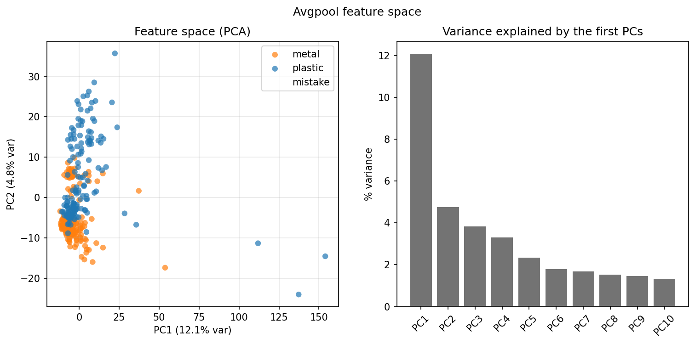
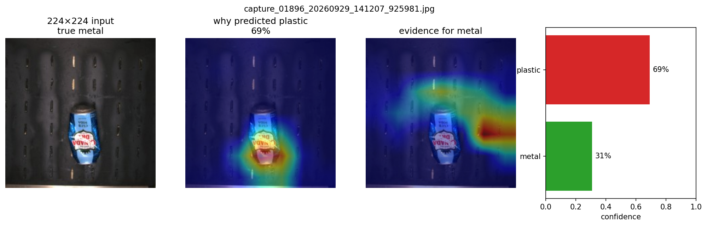
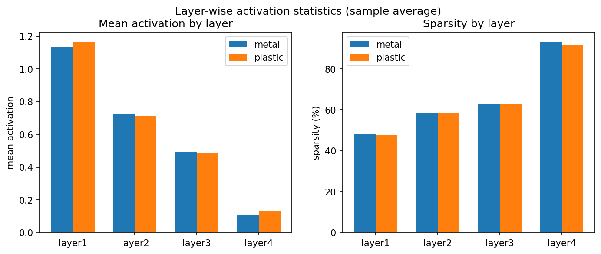
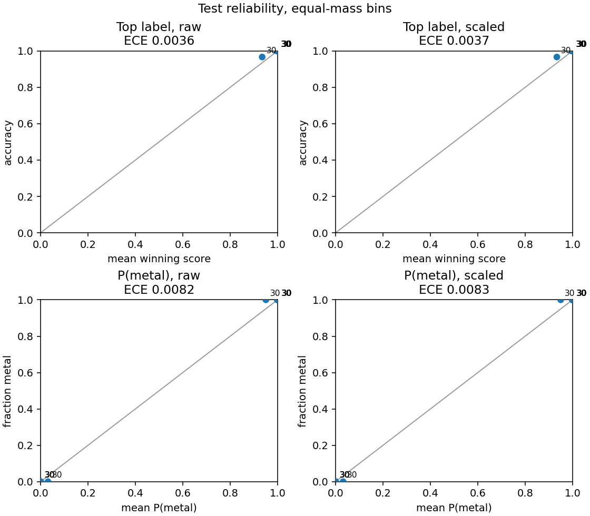

# Metal / plastic classifier

ResNeXt-50 (32×4d) labels one belt photo **metal**, **plastic**, or **uncertain**.

The current checkpoint is a Colab T4 fine-tune from 5 October 2026: `models/resnext50_metal_plastic_belt_stage1_layer4.pt`. That file stays on the training machine. **Metal** is the reject bucket (belt cans and stage 1 `OTHERS`). **Plastic** is PET, HDPE, and PP. **Uncertain** means hold the frame: the winning score has to clear 0.85.

## Test result

The locked test split is 300 images, scored once after validation picked the epoch.

| | Metal | Plastic | Overall |
|---|---:|---:|---:|
| Images | 150 | 150 | 300 |
| Correct | 149 | 150 | 299 |
| Recall | 99.33% | 100% | 99.67% |

The miss is a crushed can from 29 September 2026, called plastic at 69%. The showcase hold is 0.85. On those same test logits, 4 of 300 frames stay unsorted and the other 296 are all correct.

Validation, used only to pick the epoch, was 1,246/1,251 (99.60% accuracy, 99.11% balanced).

Counts, learning rates, and the hold sweep: [docs/belt_stage1_model_report.md](docs/belt_stage1_model_report.md). Formatted training and test pages: [docs/belt_stage1_model_report.pdf](docs/belt_stage1_model_report.pdf).

## Inspection

Same checkpoint, test split, 16 October 2026. This is the only analysis run in the repo.



Each point is one photo after average pooling. PC1 is 12.1% of the variance, PC2 is 4.8%.



The only test error, on the 224×224 frame the network scored. The middle panel is why the score went to plastic. The next panel is where a metal score would have looked.



Mean activation for metal and plastic stays close at every stage. `layer4` is mostly zeros. The class split is in the pooled vector above, which is why the PCA clouds separate while these bars do not.



Winning scores sit near 0 or 1. Top-label expected calibration error is 0.0036.

The rest of that run is in [`analysis/belt-stage1/`](analysis/belt-stage1/):

- `pca_feature-space.png`, `tsne_feature-space.png` — the 2,048-D vector in two dimensions
- `filters_side-by-side.png`, `filters_class-ranking.png` — strongest `layer4` channels
- `maps_metal_can-2026-09-29_layer1.png` through `layer4`, plus foil-tray, HDPE, and PET maps
- `cam_CORRECT_metal_metal_can-2026-09-28.png`, `cam_CORRECT_metal_metal_can-2026-09-29.png`, `cam_CORRECT_metal_OTHERS_metal_foil-tray.png`
- `mistakes_validation-and-test.png` — the six labeled misses
- `confidence/` — histogram, threshold sweep, and the per-image scores
- `stage1_excluded/` — stage 1 photos left out of the splits

## Setup

macOS or Linux:

```bash
python3 -m venv .venv
source .venv/bin/activate
pip install -r requirements.txt
```

Windows, from the repo folder:

```bat
py -m venv .venv
.venv\Scripts\activate
pip install -r requirements.txt
```

CUDA, Apple Silicon (MPS), or CPU is chosen automatically. Photos and `.pt` files are not in git. They stay on the machine that trained them.

## Train

Photos are not in git. Put them in split folders. The same file never sits in two splits.

```
data/
  train/metal/
  train/plastic/
  validation/metal/
  validation/plastic/
  test/metal/
  test/plastic/
```

```bash
python train.py
```

That starts from ImageNet weights, freezes the backbone, trains the `fc` head, and saves `models/resnext50_metal_plastic.pt`. The kept epoch is the one with the best validation accuracy.

```bash
python train.py --resume
python train.py --resume --unfreeze layer4 --lr 0.001 --lr-backbone 0.0001 --epochs 8
```

Train `fc` first. `--unfreeze layer4` also trains the last residual stage, at `--lr-backbone` (default `--lr / 10`). `layer3` and `all` are there for a later, larger set.

A Colab T4 run, once the photo zip is on Drive:

```bash
chmod +x colab_train.sh
./colab_train.sh --keep --drive --resume --unfreeze fc --epochs 6
```

## Score a photo

```bash
python train.py --eval --data-dir data_belt_stage1
python predict.py --images path/to/photo.jpg --no-show
```

`predict.py` resizes to 224×224 and draws the metal and plastic percentages. `--eval` prints validation and test accuracy and leaves the checkpoint alone.

## Jetson

```bash
pip install onnx onnxruntime
python export_onnx.py --check --data-dir data_belt_stage1
```

That writes `models/resnext50_metal_plastic.onnx` and `models/resnext50_metal_plastic.onnx.json`. The graph is two logits. The camera process still does the 224 resize, ImageNet normalize, and the 0.85 hold. Copy both files to the Jetson and build the engine there: [docs/jetson.md](docs/jetson.md). The lab page is [Jetson](http://127.0.0.1:5050/jetson).

## Lab

```bash
python -m web
```

Open http://127.0.0.1:5050. It listens on this machine only. `WEB_PORT` changes the port. Overview loads a saved analysis, searches the dataset photos, and shows how that dataset is split. Decide switches which analysis job's confidence scores are shown. Jetson copies the export command, writes the ONNX and JSON, and opens that folder in Finder or Explorer.

## Belt stage 1 counts

11,274 images at 224×224. Train, validation, and test share neither filename nor bytes.

| Split | Stage 1 metal | Belt metal | Stage 1 plastic | Belt plastic | Total |
|---|---:|---:|---:|---:|---:|
| Train | 680 | 680 | 3,949 | 3,946 | 9,255 |
| Validation | 40 | 93 | 406 | 712 | 1,251 |
| Test | 484 | 134 | 60 | 90 | 768 |

Train and validation are unchanged. Test now also holds 444 real stage 1 NonPlastic photos and the 24 boundary frames from 28–30 September. The 180 cans from 25 September were already in train and validation. The scored result above is still the original balanced test, 150 metal and 150 plastic. Synthetic stage 1 copies are not in the dataset.

## Weights and logs

A checkpoint is about 88 MB. Three of them live in `models/` on this machine, and `.gitignore` leaves them out. Loading one in PyTorch shows the weights plus three numbers: validation accuracy, balanced validation accuracy, and test accuracy. The file has no per-epoch history.

`train.py` prints each epoch to the terminal. It does not write a log file, and the Colab transcript was not kept. The lab writes a job transcript under `web/job-logs/` when a job runs. Those files are gitignored. The training record is the report linked above.
