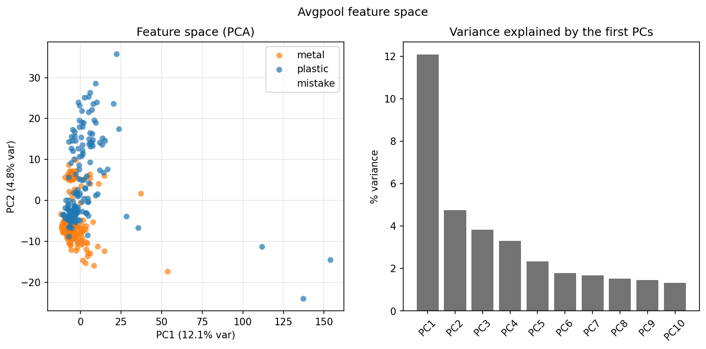
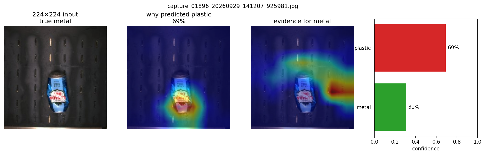
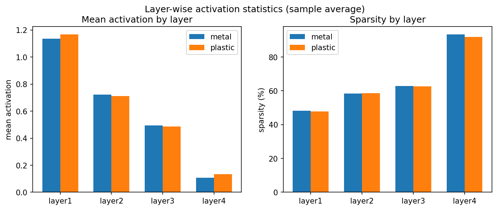
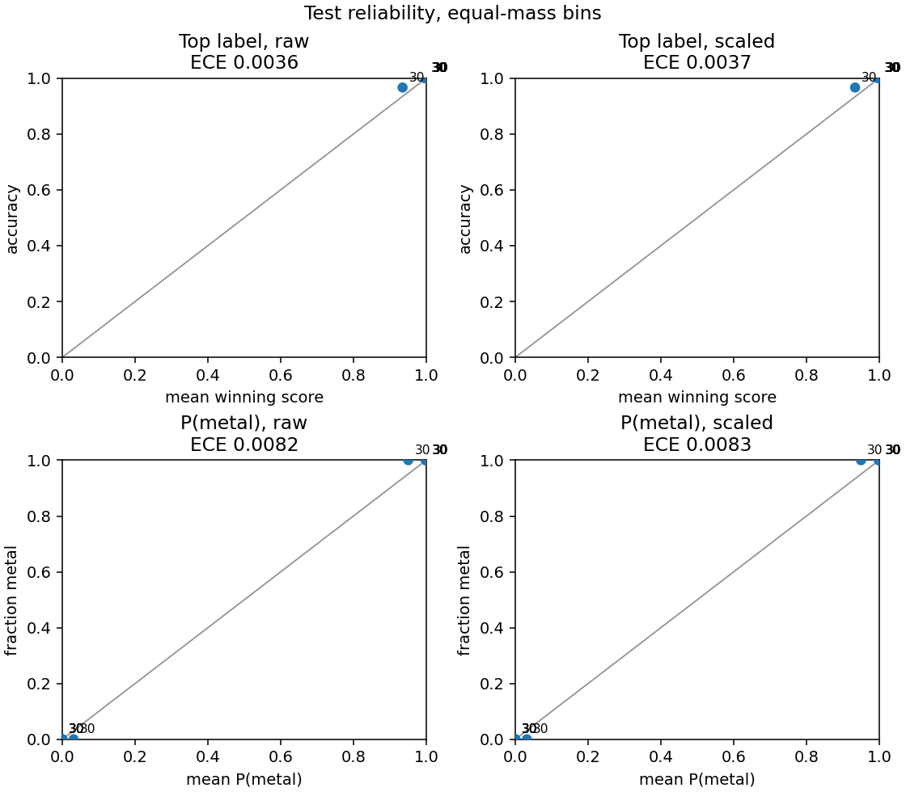

# Metal / plastic classifier

ResNeXt-50 (32×4d) labels one belt photo **metal**, **plastic**, or **uncertain**.

The default checkpoint is the 28 Oct belt-only layer4 run, `models/resnext50_metal_plastic_belt_only_layer4_20261028_20261029-105214.pt`. `models/resnext50_metal_plastic.pt` points there. Stage 1 was already out of that training set, and the 23 October cans were not in it. The file records 97.06% on the test split from that run. **Metal** is the reject bucket (belt cans, and stage 1 `OTHERS` on older checkpoints). **Plastic** is PET, HDPE, and PP. **Uncertain** means hold the frame: the winning score has to clear 0.85.

`models/replastics_best.pt` is the official 14 Oct resin head. The file is weights only. `models/replastics_best.metadata.json` names the classes HDPE, PET, PP, in that order, and records their v2_2 parity test. Models and Open set both list it. Open set fits one cloud for HDPE, one for PET, and one for PP. A tagged photo is correct when the call matches that tag. A plastic photo with no resin tag is still correct when the call is one of those three. The head has no metal class, so metal and OTHERS stay outside the clouds. Their metadata sends a score under 0.85 to review. On Open set that cutoff is still called uncertain.

## Older 5 Oct test result

The locked test split is 300 images, scored once after validation picked the epoch.

| | Metal | Plastic | Overall |
|---|---:|---:|---:|
| Images | 150 | 150 | 300 |
| Correct | 149 | 150 | 299 |
| Recall | 99.33% | 100% | 99.67% |

The miss is a crushed can from 29 September 2026, called plastic at 69%. The showcase hold is 0.85. On those same test logits, 4 of 300 frames stay unsorted and the other 296 are all correct.

Validation, used only to pick the epoch, was 1,246/1,251 (99.60% accuracy, 99.11% balanced).

Counts, learning rates, and the hold sweep: [docs/belt_stage1_model_report.md](docs/belt_stage1_model_report.md). Formatted training and test pages: [docs/belt_stage1_model_report.pdf](docs/belt_stage1_model_report.pdf).

## Inspection

Same checkpoint, test split, 16 October 2026. This is the only analysis run in the repo.



Each point is one photo after average pooling. PC1 is 12.1% of the variance, PC2 is 4.8%.



The only test error, on the 224×224 frame the network scored. The middle panel is why the score went to plastic. The next panel is where a metal score would have looked.



Mean activation for metal and plastic stays close at every stage. `layer4` is mostly zeros. The class split is in the pooled vector above, which is why the PCA clouds separate while these bars do not.



Winning scores sit near 0 or 1. Top-label expected calibration error is 0.0036.

The rest of that run is in [`analysis/belt-stage1/`](analysis/belt-stage1/):

- `pca_feature-space.png`, `tsne_feature-space.png` — the 2,048-D vector in two dimensions
- `filters_side-by-side.png`, `filters_class-ranking.png` — strongest `layer4` channels
- `maps_metal_can-2026-09-29_layer1.png` through `layer4`, plus foil-tray, HDPE, and PET maps
- `cam_CORRECT_metal_metal_can-2026-09-28.png`, `cam_CORRECT_metal_metal_can-2026-09-29.png`, `cam_CORRECT_metal_OTHERS_metal_foil-tray.png`
- `mistakes_validation-and-test.png` — the six labeled misses
- `confidence/` — histogram, threshold sweep, and the per-image scores
- `stage1_excluded/` — stage 1 photos left out of the splits

## Setup

macOS or Linux:

```bash
python3 -m venv .venv
source .venv/bin/activate
pip install -r requirements.txt
```

Windows, from the repo folder:

```bat
py -m venv .venv
.venv\Scripts\activate
pip install -r requirements.txt
```

CUDA, Apple Silicon (MPS), or CPU is chosen automatically. Photos and `.pt` files are not in git. They stay on the machine that trained them.

## Train

Photos are not in git. Put them in split folders. The same file never sits in two splits.

```
data/
  train/metal/
  train/plastic/
  validation/metal/
  validation/plastic/
  test/metal/
  test/plastic/
```

```bash
python train.py
```

That starts from ImageNet weights, freezes the backbone, trains the `fc` head, and saves `models/resnext50_metal_plastic.pt`. The kept epoch is the one with the best validation accuracy.

```bash
python train.py --resume
python train.py --resume --unfreeze layer4 --lr 0.001 --lr-backbone 0.0001 --epochs 8
```

Train `fc` first. `--unfreeze layer4` also trains the last residual stage, at `--lr-backbone` (default `--lr / 10`). `layer3` and `all` are there for a later, larger set. `--weight-power 0` turns class weighting off. `--fresh-best` keeps this run's best epoch even when that score is below the checkpoint you resumed.

A Colab T4 run. The photo zip is `~/Downloads/belt_stage1_224.zip` on this computer:

```bash
chmod +x colab_train.sh
./colab_train.sh --keep --drive --resume --unfreeze layer4 \
  --lr 0.0003 --lr-backbone 0.00003 --weight-power 0.5 --epochs 4 \
  --model models/resnext50_metal_plastic_belt_stage1_layer4.pt
```

`--drive` uploads that Downloads zip. Drive's copy is not read. The weights are the `--model` file on this computer, uploaded as-is. The trained checkpoint is saved as a new file. The one you passed stays.

## Score a photo

```bash
python train.py --eval --data-dir data_belt_stage1
python predict.py --images path/to/photo.jpg --no-show
python analyze.py --steps cam --images path/to/photo.jpg --no-show
```

`predict.py` resizes to 224×224 and draws the metal and plastic percentages. `--eval` prints validation and test accuracy and leaves the checkpoint alone. `analyze.py --steps cam` writes a Grad-CAM figure for that photo under `analysis/`. A photo that is not in a class folder still gets one. More than 32 files is sampled.

## Jetson

```bash
pip install onnx onnxruntime
python export_onnx.py --model models/resnext50_metal_plastic.pt --check --data-dir data_belt_stage1
```

That writes `models/resnext50_metal_plastic.onnx` and `models/resnext50_metal_plastic.onnx.json`. Another checkpoint writes `models/<that stem>.onnx`. The graph is two logits. `--check` scores every test photo in PyTorch and in ONNX Runtime and prints accuracy, balanced accuracy, and any label that changed. It stops when a label changes. `--check-only` scores an ONNX file already on disk. The camera process still does the 224 resize, ImageNet normalize, and the 0.85 hold. Copy both files to the Jetson and build the engine there: [docs/jetson.md](docs/jetson.md). The lab page is [Jetson](http://127.0.0.1:5050/jetson). Pick the checkpoint there. Check ONNX re-scores the file already written, and those scores stay on the page.

## Lab

```bash
python -m web
```

Open http://127.0.0.1:5050. It listens on this machine only. `WEB_PORT` changes the port. Open set is http://127.0.0.1:5050/open-set. Build fits train centroids for the checkpoint you pick, then scores validation and test. A resin head fits HDPE, PET, and PP only, and leaves metal and OTHERS out of that fit. The distance mark is the 99th percentile on validation photos the model got right. Rerun asks before test is scored again. The tiles are percentages of the split you are looking at, with the counts underneath, including the Decide figures and a split of uncertain into a right call and a wrong call. A keep line accepts a photo once confidence is high enough, whatever the distance. Fit on validation can place that line, or that line and the distance mark, and it skips a candidate that would hold more than 5% of validation. Test does not pick it. Drop a photo, or name a folder such as `data/probes`, to score it on the saved bank. Empty or unreadable files in that folder are skipped. Nested `metal`, `plastic`, and `other` folders keep those labels, and `other` is the unknown class. The plot scrolls to zoom, drags to pan, and shift-drags a box around a tight cluster. The photo list colors follow the sliders: teal is kept, amber is others, gray is uncertain, and red is a wrong class the filters still accepted. On a resin head the plot colors HDPE, PET, and PP. A tagged photo counts as right only when the call matches that tag, and an untagged plastic photo counts as right when the call is one of those three. Hide metal drops metal and OTHERS from the plot and the lists. Hover shows the true class, the predicted class, confidence, and distance. Sort can put those first. Validation and test can join that list. Others means the vector is outside the fitted clouds. Uncertain still means the winning score is under the cutoff. Neither one changes the 0.85 hold. Belt is http://127.0.0.1:5050/belt. Build measures foreground area and fits a centroid on `data/probes/blanks`, then picks an area cut on validation that catches blank frames while holding at most 1% of that split. A second cut holds a small object only when its pooled vector is also near that centroid. Test is scored once. Rerun asks before test is scored again. Empty means the belt has nothing large enough to sort. It does not change the 0.85 hold. Pipeline is http://127.0.0.1:5050/pipeline. Belt checks and checkpoints are cards you wire together. Drag a toolbar button onto the board and the card lands there. Score writes each photo’s belt numbers and each checkpoint’s open-set scores once, and the board fills in when that job finishes. Moving a card, a cut, or a confidence mark after that does not score again. A model card’s outputs are the checkpoint’s classes, so the RePlastics head exposes HDPE, PET, and PP. A sink with that name is correct when the photo’s resin matches it. An untagged plastic photo still counts as right for any of those three calls. Save writes the board to `analysis/pipelines`, and Load reads that name back. Score this checkpoint on a model card scores only that file and leaves the belt cache. Click a card to open its photos, and shift-click to keep another step on screen. Other steps stay collapsed, with the full port counts on the bar. The grid scrolls in place. Green is right, red is wrong, amber is others, and gray is uncertain or empty. Show distance is off until you ask for it, and a model card can ignore distance. The grids can hide metal, keep only right or wrong calls, pick one class, set a minimum confidence, or show the same count from each class. Fit on a model card searches validation only, and it skips a rule that would leave more than 5% of validation in a hold pile or on an unwired port. Test does not pick that fit.

Jobs lists every checkpoint with the validation, balanced, and test scores stored in the file, and a T4 run uploads the one you pick plus `~/Downloads/belt_stage1_224.zip`. Drive's copy of that zip is not read. Overview loads a saved analysis, searches the dataset photos, and shows how that dataset is split. Decide is on every checkpoint, and the 0.85 hold applies to each of them. When scores are loaded, Hide metal drops metal and OTHERS from the figures and the photo sheet, and a plastic photo shows its resin beside the folder. When the checkpoint’s classes are HDPE, PET, and PP, the confusion table, the balanced score, the histogram, and the photo marks use those classes. With saved logits it switches which analysis job's confidence scores are shown. Without them it offers a confidence report. Start on Jobs makes one copy of the checkpoint you picked and trains that copy. The file you picked stays. Delete or rename a checkpoint from Models. Filter and sort are on that page. The name is the label. The file field moves the checkpoint, the ONNX pair beside it, and its analysis folder. `models/names.json` keeps the label. Small, Medium, and Large set the photo sheet, and a click opens that photo so the arrow keys can move through the group. That photo has Run Grad-CAM. The Run tab also takes a JPEG, PNG, or WebP from this computer, and the figure lands in the newest analysis run. Jetson picks the checkpoint, copies the export command, writes an ONNX named after that file, scores the test split against PyTorch, and can re-score an ONNX file already on disk. It opens that folder in Finder or Explorer.

## Belt stage 1 counts

Train and validation are belt photos only. Stage 1 is out of test as well. Those 5,619 photos are in `data_belt_stage1/removed_stage1/`. Test is the earlier belt photos plus the 499 cans from 23 October 2026. `~/Downloads/belt_stage1_224.zip` is a copy of these folders. The Data page button zips what is on disk. It does not put `removed_stage1` back.

| Split | Stage 1 metal | Belt metal | Stage 1 plastic | Belt plastic | Total |
|---|---:|---:|---:|---:|---:|
| Train | 0 | 677 | 0 | 3,949 | 4,626 |
| Validation | 0 | 93 | 0 | 712 | 805 |
| Test | 0 | 633 | 0 | 90 | 723 |

Belt metal in test is the original 134 plus those 499. Three 30 September bottles that were filed as metal are now plastic in train. The other 28–30 September can windows are unchanged, including the 24 boundary frames. The 180 cans from 25 September stay in train and validation. The six foil trays the 5 Oct checkpoint calls plastic stay in their splits. The scored result above is still that checkpoint's balanced test, 150 metal and 150 plastic. Synthetic stage 1 copies are not in the dataset.

`data_belt_oct23` is a copy of these folders. 318 earlier October cans are in train. Validation has 40 other October cans from that same stretch, plus 8 October cans the 29 Oct checkpoint calls plastic: the Sprite can, `capture_00192`, `capture_00346`, `capture_00444`, `capture_00329`, `capture_00160`, `capture_00024`, and `capture_00370`. Test keeps the other 13 of those misses, including the Red Bull nutrition-facts can, and the latest 120 October cans that checkpoint already calls metal. `data_belt_stage1` is unchanged, and the T4 zip is still that folder. Pick `data_belt_oct23` in the dataset menu and leave Use Drive zip unchecked.

| Split | Metal | Plastic | Total |
|---|---:|---:|---:|
| Train | 995 | 3,949 | 4,944 |
| Validation | 141 | 712 | 853 |
| Test | 267 | 90 | 357 |

## Weights and logs

A checkpoint is about 88 MB. The files live in `models/` on this machine, and `.gitignore` leaves them out. Loading one in PyTorch shows the weights plus the scores from the run that saved it: validation accuracy, balanced validation accuracy, and test accuracy. The file has no per-epoch history. `models/resnext50_metal_plastic.pt` is the default link, and it points at the 28 Oct belt-only layer4 checkpoint.

`train.py` prints each epoch to the terminal. It does not write a log file, and the Colab transcript was not kept. The lab writes a job transcript under `web/job-logs/` when a job runs. Those files are gitignored. The training record is the report linked above.
