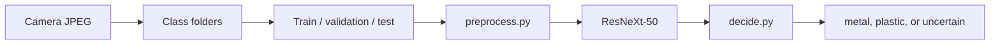

# How this repo works

This repo trains one camera classifier: a photo of an object on the belt comes in, and the model answers **metal**, **plastic**, or **uncertain**. Everything else exists to build a leak-free dataset, train that model without wrecking its starting weights, score it honestly, and get the same job done on a Colab GPU.

## What the model actually is

The network is **ResNeXt-50 (32×4d)**. It was originally trained on ImageNet to tell 1,000 everyday object classes apart. `train.py` throws away that 1,000-way last layer and replaces it with a linear layer from 2,048 features down to **2 classes**.

The two class names are `metal` and `plastic`, but the folder named metal is a **reject bucket**, not “this object is made of metal.”

| What you see | What the model is taught |
|---|---|
| PET, HDPE, PP | plastic |
| Belt cans | metal |
| Stage 1 `OTHERS` (foil trays, odd bottles, other rejects) | metal |

`uncertain` is not a third class. After the two scores are computed, if the winner is below **0.85**, the frame is held and not sorted. That cutoff lives in `decide.py`. The measurement had picked 0.97. The live cutoff is lower so a showcase sorts the confident calls.

The current weights are `models/resnext50_metal_plastic_belt_stage1_layer4.pt`. The default path `models/resnext50_metal_plastic.pt` is a link to that file. On the locked 300-image test split it got 149/150 metal and 150/150 plastic. With the 0.85 hold on those same logits, 4 of those 300 stay unsorted and the other 296 are correct. The write-up is `docs/belt_stage1_model_report.md`.

## The path a photo takes



1. A photo lands in a class folder. The folder name, or a `_HDPE` / `_PET` / `_PP` / `_OTHERS` tag on the filename, is the label.
2. A split script puts it in **train**, **validation**, or **test**. The same file never sits in two of those.
3. `preprocess.py` turns it into the tensor the network expects: 224×224, then ImageNet mean and standard deviation.
4. `train.py` updates the weights. Validation chooses which epoch to keep. Test is scored once, after that choice.
5. `predict.py` runs the saved weights on new photos. `decide.py` turns the raw scores into a label, and holds the frame when the winner is too weak.

Train and production do not see the photo the same way. Training randomly crops into the object (at least 60% of the frame), flips it, and rotates it up to 15°. Evaluation and the belt both take the **whole frame**, resize it with bilinear interpolation to 224×224, and normalize. That full-frame resize is what production should copy.

## Why the training is staged

ImageNet already knows edges, color, and object shape. Training the whole network first on a few thousand belt photos would overwrite that. So training always starts at the top and works downward:

1. **`--unfreeze fc`** — every residual stage stays frozen. Only the new 2-class layer learns.
2. **`--unfreeze layer4`** — the last residual stage learns too, at a learning rate ten times smaller.
3. **`layer3` / `all`** exist in the code and are almost never the right next step on this data.

The current checkpoint did step 1 for 6 epochs, then step 2 for 4 epochs, starting from an older Drive checkpoint that was already at 99% on a different set. The saved file is the epoch with the best **balanced validation accuracy**: the average of metal recall and plastic recall. Overall accuracy is the wrong score here. Train is about 6 plastic photos per metal photo, so a model that calls everything plastic can still print ~96%.

The loss is weighted cross-entropy. Metal’s weight is higher (1.845 vs 0.766 at power 0.5) so the scarce cans still move the weights. Validation and test loss stay unweighted, so those numbers match what you would report.

## The files, by job

### Shared by almost every script

**`preprocess.py`** is the contract between training, scoring, and the belt. It maps folder names and resin tags onto `metal` / `plastic`, opens JPEGs as RGB (including phone EXIF rotation), skips empty or corrupt files, and defines the two image transforms. `tensor_to_display` undoes the ImageNet normalization so a plot shows the actual 224×224 square the network scored.

**`trashnet.py`** only knows the folder layout: `train/metal`, `train/plastic`, and the same for `validation` and `test`. `train.py` refuses to start if that layout is missing. The name is leftover from an earlier TrashNet-style dataset.

**`decide.py`** is the production rule. Temperature **1.011839** slightly rescales the logits before the softmax. Threshold **0.85** holds a frame whose winning score is lower than that. The temperature and the original 0.97 measurement were fit on `data_belt_stage1` validation. The live hold was lowered for the showcase. Both apply only when the loaded file is the belt stage 1 checkpoint. An older checkpoint keeps a plain softmax unless you pass `--threshold`.

**`export_onnx.py`** writes the ONNX graph the Jetson builds into a TensorRT engine. It loads the checkpoint the same way as `predict.py` and exports `model.forward` only: one normalized 224×224 image in, two logits out. The JSON beside it carries `class_to_idx`, the ImageNet mean and std, and the frozen temperature and threshold. Resize and the hold stay out of the file. The build steps are `docs/jetson.md`.

### Training and scoring

**`train.py`** is the training loop. It picks CUDA, Apple Silicon, or CPU, loads the three splits, builds ResNeXt-50, swaps in the 2-class head, freezes the stages you did not ask to train, and runs AdamW. Each epoch it trains, scores validation, and writes the checkpoint immediately if balanced accuracy improved, so Ctrl+C does not lose the best weights. After training it scores the test split once and writes `confusion_matrix.png` plus `misclassified_validation.txt` / `.png`. `--eval` scores validation and test and leaves the checkpoint alone. `--resume` continues from a saved file.

**`predict.py`** is how you look at the model’s answers. With no `--images` it samples the test split. With `--images` it scores any files or folders. It draws metal and plastic percentages on the 224×224 view. `--mistakes-out` scores every labeled image and writes only the errors. Frames the hold rule marks `uncertain` are left out of that mistake list. It will not overwrite `misclassified_validation.png`.

**`analyze.py`** asks why a score happened, using the same images and checkpoint as `predict.py`. It writes plots under `analysis/`:

- **Feature maps** — which filters fired in `layer1` through `layer4`. Early layers look like edges; `layer4` is a coarse 7×7 blob.
- **Grad-CAM** — where on the photo the class score was looking.
- **Layer stats** — whether metal and plastic still look the same inside a frozen backbone.
- **PCA / t-SNE** — whether the 2,048-dimensional pooled vectors form two blobs or one mixed cloud.

**`confidence_report.py`** is the measurement that produced the numbers now hardcoded in `decide.py`. It fits the temperature on validation by minimizing negative log likelihood, sweeps thresholds, and keeps the cutoff that catches the most validation mistakes while holding at most 5% of that split. It then scores the locked test split once and writes `analysis/belt-stage1/confidence/`. A later run stops if `test_scored.txt` is already there, so the test set is not silently reused to tune the rule.

### Building the datasets

These scripts do not train. They exist because the photos arrived in different shapes, from different days, and a random shuffle would leak near-duplicate belt frames into both train and test.

**`split_data.py`** is the simple splitter. You drop unsplitted `metal/` and `plastic/` folders into a root, and it copies them 70% / 15% / 15% with seed 42, then deletes the unsplitted folders. `--dest data_real` keeps that tree separate from the original `data/`.

**`resize_stage1.py`** reads the live Google Drive folder `stage1_binary_v2` (`train|val` / `NonPlastic|Plastic`), resizes every photo to 224×224, and writes `~/Downloads/stage1_binary_v2_256`. The folder name is historical; the files inside are 224.

**`relabel_stage1.py`** is a label-review tool for that Drive tree. `suggest` lists photos the model disagrees with. On this set that is mostly foil trays the network calls plastic, and those labels are correct, so you do not write the proposal unless you actually found a folder mistake. `promote-val` moves half of each validation class into train and records the stems that stay in validation. It does not touch the locked test list.

**`stage1_locked_test_stems.txt`** and **`stage1_locked_val_stems.txt`** are those frozen filename lists, one `class<TAB>stem` per line. Later rebuilds must keep those files in the split they were measured in.

**`build_belt_stage1.py`** is the dataset the current model was trained on. It combines the resized stage 1 photos with the September belt dump, resizes everything to 224, and writes `data_belt_stage1/` plus `~/Downloads/belt_stage1_224.zip`. The scored test number comes from the balanced 300-image split. Other stage 1 metal is split between validation and test so those two metal counts match.

- The scored test is 150 metal and 150 plastic. Locked stage 1 test stems stay in test.
- The 28–30 September cans keep a contiguous validation and test window. The two-frame gap on each side goes to test.
- Synthetic stage 1 NonPlastic copies are dropped.
- Real stage 1 NonPlastic training photos are cut down to 680 so they match the 680 belt cans in train. The rest start in test, then move to validation until metal validation and metal test differ by at most one. A 5-second burst stays together. The six foil trays called plastic are pinned two to train, one to validation, and three to test.
- The same filename and the same file bytes are checked across train, validation, and test.

**`prepare_drive_data.py`** runs on the Colab VM. It unzips the uploaded archive onto local VM disk and remaps `NonPlastic` → `metal`. It uses the zip path it was given and does not search Drive for a different file. Training then reads local files.

### Getting that training onto a Colab GPU

A Mac can run `train.py`, but the long runs happened on a Colab T4. The shell script is the entry point; the three Python files are workarounds for Colab CLI bugs.

**`colab_train.sh`** starts a GPU session, uploads the training scripts, uploads `~/Downloads/belt_stage1_224.zip` and the `--model` checkpoint from this computer, then runs `train.py`. Drive's copy of the zip is not read. Colab was still serving the 5 Oct zip after the file on this computer had changed. A missing upload is not replaced with another zip or another checkpoint. The trained file is downloaded under a new name. The file you resumed stays. `--keep` leaves the VM up so the photos survive between runs.

**`colab_drivemount.py`** mounts Drive with the headers the official `colab drivemount` command omits. Without them Colab returns an HTML error and training never sees the photos.

**`colab_upload.py`** uploads a large file in 4 MB pieces. The stock uploader base64-encodes the whole file in one request and dies on a multi-gigabyte payload. The checkpoint uses the same uploader.

**`colab_copy_checkpoint.py`** used to copy weights off Drive and, if the named file was missing, took a different checkpoint. It now refuses. Training does not call it.

**`requirements.txt`** is the Mac environment: PyTorch, torchvision, matplotlib, scikit-learn, Pillow. **`requirements-colab.txt`** is only matplotlib, scikit-learn, and Pillow, because Colab already has PyTorch.

### Records, not code

**`README.md`** is the operating manual: the commands, the flags, and which checkpoint to leave alone.

**`docs/belt_stage1_model_report.md`** is the training record for the current checkpoint: counts, learning rates, the confusion matrix, and the uncertain-frame rule. **`docs/belt_stage1_model_report.pdf`** is the formatted training and test pages from that record. It does not include the uncertain-frame section.

The current plots live in `analysis/belt-stage1/`, and that folder is the one analysis run kept in git. Other runs under `analysis/` stay local, along with the image trees, the zip files, and the `.pt` checkpoints. `train.py` still writes `confusion_matrix.png` and `misclassified_validation.png` in the repo root after a training run; those files are local and are not this checkpoint's record.

## How a normal run fits together

On your machine, once `data_belt_stage1/` exists:

```bash
python train.py --resume --data-dir data_belt_stage1 --unfreeze layer4 \
  --lr 0.0003 --lr-backbone 0.00003 --weight-power 0.5 --epochs 4
python predict.py --images path/to/frame.jpg
python confidence_report.py
```

On Colab, the same training is:

```bash
./colab_train.sh --keep --drive --resume --unfreeze layer4 \
  --lr 0.0003 --lr-backbone 0.00003 --weight-power 0.5 --epochs 4
```

That script uploads the checkpoint from this computer, calls `colab_drivemount.py`, then `prepare_drive_data.py`, then `train.py`. The trained file comes back under a new name. Afterward, `predict.py` and `decide.py` are what the belt should imitate: full-frame bilinear resize to 224, ImageNet normalize, softmax of logits divided by 1.011839, and a hold when the winning score is under 0.85. `export_onnx.py` writes that network as ONNX, and `docs/jetson.md` is how the Jetson turns it into the engine it loads.
